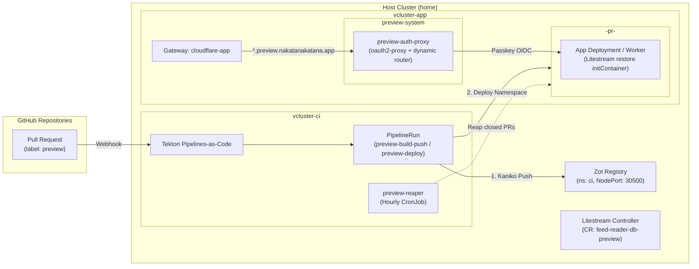

# Pull Request Preview Environment Setup Guide

This guide documents the architecture, cluster prerequisites, 1Password secret setup, PocketID OIDC configuration, and application repository integration for the automated Pull Request preview environment.

---

## 1. Architecture Overview

The PR preview environment enables isolated, on-demand testing of pull requests for applications (e.g., `feed-reader` and `mytools` services) without committing ephemeral manifests to this repository or publishing container images to external registries.



### Key Components

| Component | Location | Role |
| --- | --- | --- |
| **Zot Registry** | Host `ci` namespace | In-cluster OCI registry backed by Ceph block storage (`rook-ceph-block`). Built images are pushed from `vcluster-ci` via `zot-registry.tekton-workspace.svc.cluster.local:5000` and pulled by Kubernetes nodes on `localhost:30500` without requiring external image publication or TLS configuration on node runtimes. |
| **Pipelines-as-Code** | `vcluster-ci` | Listens to GitHub webhook events, validates sender permissions, evaluates CEL expressions to enforce the `preview` label requirement, and triggers isolated Tekton pipelines. |
| **Ephemeral Namespaces** | `vcluster-app` | Each active PR runs in an isolated namespace `<app>-pr-<num>` containing an ephemeral Deployment, Service (`preview-http:8080`), and an HTTPRoute in `preview-system`. |
| **Litestream Restore-Only** | Host `app` namespace | Custom resource `feed-reader-db-preview` restores SQLite data from production S3 backups into an ephemeral `emptyDir` on startup via a mutating webhook initContainer, without replicating any changes back. |
| **PocketID Auth Gateway** | `vcluster-app` (`preview-system`) | Multi-container Pod running `oauth2-proxy` and an Nginx dynamic router. Authenticates requests via PocketID (`https://id.nakatanakatana.app`) using passkeys, sets a wildcard session cookie on `.preview.nakatanakatana.app`, and forwards traffic to `http://preview-http.<app>-pr-<num>.svc.cluster.local:8080`. |
| **Preview Reaper** | `vcluster-ci` | Hourly fail-safe CronJob that queries the GitHub API for each active preview namespace and purges any environments whose PR is closed or no longer labeled `preview`. |

---

## 2. Required 1Password Secret Items

One new 1Password item must be provisioned in the `k8s` vault synced by `1password-sdk` (the `vcluster-app-kubeconfig` secret is synced directly from the in-cluster `app/vc-vcluster` secret, and `tekton-preview-github` reuses the existing `pac-github-app` item):

### `preview-pocket-id`

Used by `preview-auth-proxy` in `preview-system` to authenticate against PocketID via OIDC.

| Field Name | Type | Description |
| --- | --- | --- |
| `client_id` | Text | Client ID generated in PocketID for the preview environment. |
| `client_secret` | Password | Client secret generated in PocketID. |
| `cookie_secret` | Password | 32-byte base64url-encoded key for `oauth2-proxy` cookie encryption. |

To generate the `cookie_secret`:
```bash
python3 -c 'import secrets; print(secrets.token_urlsafe(32))'
```

---

## 3. PocketID OIDC Client Setup

Register a new OIDC client in the PocketID administration interface at `https://id.nakatanakatana.app`:

1. Navigate to **Administration > OIDC Clients > Add Client**.
2. Configure the client details:
   - **Name**: `PR Preview Environments`
   - **Client ID**: (copy into 1Password `preview-pocket-id/client_id`)
   - **Callback URLs / Redirect URIs**:
     ```
     https://auth.preview.nakatanakatana.app/oauth2/callback
     ```
   - **Allowed Scopes**: `openid`, `profile`, `email`
   - **Grant Types**: `Authorization Code`
   - **PKCE**: Optional / Default
3. Copy the generated **Client Secret** into 1Password `preview-pocket-id/client_secret`.
4. Verify that user groups permitted to access preview environments are assigned to this client.

---

## 4. Application Repository Setup (`.tekton/`)

To enable PR preview environments in an application repository, add two Pipelines-as-Code pipeline definitions under `.tekton/`:

1. `.tekton/preview-deploy.yaml`: Builds the container image with Kaniko, pushes to Zot, and provisions the preview environment when a PR is labeled with `preview` or updated.
2. `.tekton/preview-cleanup.yaml`: Tears down the preview environment when the PR is closed or the `preview` label is removed.

### Example A: Single Application (`feed-reader`)

`feed-reader` is an HTTP application with a restored SQLite database seeded via Litestream.

#### `.tekton/preview-deploy.yaml`

```yaml
apiVersion: tekton.dev/v1
kind: PipelineRun
metadata:
  name: feed-reader-preview-deploy
  annotations:
    pipelinesascode.tekton.dev/on-cel-expression: |
      event == "pull_request" &&
      body.action in ["labeled", "synchronize", "reopened"] &&
      body.pull_request.head.repo.full_name == body.repository.full_name &&
      body.pull_request.labels.exists(l, l.name == "preview")
    pipelinesascode.tekton.dev/task: "[preview-build-push, preview-deploy]"
    pipelinesascode.tekton.dev/max-keep-runs: "3"
spec:
  params:
    - name: repo_url
      value: "{{repo_url}}"
    - name: revision
      value: "{{revision}}"
    - name: pull_request_number
      value: "{{pull_request_number}}"
  pipelineSpec:
    workspaces:
      - name: source
    tasks:
      - name: fetch-repository
        taskRef:
          name: git-clone
        workspaces:
          - name: output
            workspace: source
        params:
          - name: url
            value: $(params.repo_url)
          - name: revision
            value: $(params.revision)

      - name: build-push
        runAfter:
          - fetch-repository
        taskRef:
          name: preview-build-push
        workspaces:
          - name: source
            workspace: source
        params:
          - name: APP_NAME
            value: feed-reader
          - name: PR_NUMBER
            value: $(params.pull_request_number)
          - name: COMMIT_SHA
            value: $(params.revision)

      - name: deploy
        runAfter:
          - build-push
        taskRef:
          name: preview-deploy
        workspaces:
          - name: source
            workspace: source
        params:
          - name: APP_NAME
            value: feed-reader
          - name: PR_NUMBER
            value: $(params.pull_request_number)
          - name: COMMIT_SHA
            value: $(params.revision)
          - name: REPO_FULL_NAME
            value: "{{repo_owner}}/{{repo_name}}"
          - name: EXPOSE_HTTP
            value: "true"
          - name: PORT
            value: "8080"
          - name: LITESTREAM_INJECT
            value: feed-reader-db-preview
  workspaces:
    - name: source
      volumeClaimTemplate:
        spec:
          accessModes:
            - ReadWriteOnce
          resources:
            requests:
              storage: 1Gi
```

#### `.tekton/preview-cleanup.yaml`

```yaml
apiVersion: tekton.dev/v1
kind: PipelineRun
metadata:
  name: feed-reader-preview-cleanup
  annotations:
    pipelinesascode.tekton.dev/on-cel-expression: |
      event == "pull_request" &&
      (body.action == "closed" || (body.action == "unlabeled" && body.label.name == "preview")) &&
      body.pull_request.head.repo.full_name == body.repository.full_name
    pipelinesascode.tekton.dev/task: "[preview-cleanup]"
    pipelinesascode.tekton.dev/max-keep-runs: "3"
spec:
  pipelineSpec:
    tasks:
      - name: cleanup
        taskRef:
          name: preview-cleanup
        params:
          - name: APP_NAME
            value: feed-reader
          - name: PR_NUMBER
            value: "{{pull_request_number}}"
```

---

### Example B: Monorepo with HTTP Service and Background Worker (`mytools`)

`mytools` is a monorepo containing multiple components:
- `apps/http-tool`: An HTTP service exposed publicly at `https://mytools-http-tool-pr-<num>.preview.nakatanakatana.app`.
- `apps/worker`: A background worker running in its own namespace without public HTTP ingress.

#### `.tekton/preview-deploy.yaml`

```yaml
apiVersion: tekton.dev/v1
kind: PipelineRun
metadata:
  name: mytools-preview-deploy
  annotations:
    pipelinesascode.tekton.dev/on-cel-expression: |
      event == "pull_request" &&
      body.action in ["labeled", "synchronize", "reopened"] &&
      body.pull_request.head.repo.full_name == body.repository.full_name &&
      body.pull_request.labels.exists(l, l.name == "preview")
    pipelinesascode.tekton.dev/task: "[preview-build-push, preview-deploy]"
    pipelinesascode.tekton.dev/max-keep-runs: "3"
spec:
  params:
    - name: repo_url
      value: "{{repo_url}}"
    - name: revision
      value: "{{revision}}"
    - name: pull_request_number
      value: "{{pull_request_number}}"
  pipelineSpec:
    workspaces:
      - name: source
    tasks:
      - name: fetch-repository
        taskRef:
          name: git-clone
        workspaces:
          - name: output
            workspace: source
        params:
          - name: url
            value: $(params.repo_url)
          - name: revision
            value: $(params.revision)

      # -----------------------------------------------------------------------
      # 1. HTTP Service Component (apps/http-tool)
      # -----------------------------------------------------------------------
      - name: build-push-http-tool
        runAfter:
          - fetch-repository
        taskRef:
          name: preview-build-push
        workspaces:
          - name: source
            workspace: source
        params:
          - name: APP_NAME
            value: mytools-http-tool
          - name: PR_NUMBER
            value: $(params.pull_request_number)
          - name: COMMIT_SHA
            value: $(params.revision)
          - name: CONTEXT_DIR
            value: apps/http-tool
          - name: DOCKERFILE
            value: Dockerfile

      - name: deploy-http-tool
        runAfter:
          - build-push-http-tool
        taskRef:
          name: preview-deploy
        workspaces:
          - name: source
            workspace: source
        params:
          - name: APP_NAME
            value: mytools-http-tool
          - name: PR_NUMBER
            value: $(params.pull_request_number)
          - name: COMMIT_SHA
            value: $(params.revision)
          - name: REPO_FULL_NAME
            value: "{{repo_owner}}/{{repo_name}}"
          - name: EXPOSE_HTTP
            value: "true"
          - name: PORT
            value: "8080"

      # -----------------------------------------------------------------------
      # 2. Background Worker Component (apps/worker)
      # -----------------------------------------------------------------------
      - name: build-push-worker
        runAfter:
          - fetch-repository
        taskRef:
          name: preview-build-push
        workspaces:
          - name: source
            workspace: source
        params:
          - name: APP_NAME
            value: mytools-worker
          - name: PR_NUMBER
            value: $(params.pull_request_number)
          - name: COMMIT_SHA
            value: $(params.revision)
          - name: CONTEXT_DIR
            value: apps/worker
          - name: DOCKERFILE
            value: Dockerfile

      - name: deploy-worker
        runAfter:
          - build-push-worker
        taskRef:
          name: preview-deploy
        workspaces:
          - name: source
            workspace: source
        params:
          - name: APP_NAME
            value: mytools-worker
          - name: PR_NUMBER
            value: $(params.pull_request_number)
          - name: COMMIT_SHA
            value: $(params.revision)
          - name: REPO_FULL_NAME
            value: "{{repo_owner}}/{{repo_name}}"
          - name: EXPOSE_HTTP
            value: "false"
  workspaces:
    - name: source
      volumeClaimTemplate:
        spec:
          accessModes:
            - ReadWriteOnce
          resources:
            requests:
              storage: 1Gi
```

#### `.tekton/preview-cleanup.yaml`

```yaml
apiVersion: tekton.dev/v1
kind: PipelineRun
metadata:
  name: mytools-preview-cleanup
  annotations:
    pipelinesascode.tekton.dev/on-cel-expression: |
      event == "pull_request" &&
      (body.action == "closed" || (body.action == "unlabeled" && body.label.name == "preview")) &&
      body.pull_request.head.repo.full_name == body.repository.full_name
    pipelinesascode.tekton.dev/task: "[preview-cleanup]"
    pipelinesascode.tekton.dev/max-keep-runs: "3"
spec:
  pipelineSpec:
    tasks:
      - name: cleanup-http-tool
        taskRef:
          name: preview-cleanup
        params:
          - name: APP_NAME
            value: mytools-http-tool
          - name: PR_NUMBER
            value: "{{pull_request_number}}"

      - name: cleanup-worker
        taskRef:
          name: preview-cleanup
        params:
          - name: APP_NAME
            value: mytools-worker
          - name: PR_NUMBER
            value: "{{pull_request_number}}"
```

---

## 5. Security and Operational Notes

1. **Untrusted Pull Request Protection**:
   - The CEL expressions check `body.pull_request.head.repo.full_name == body.repository.full_name`. Pull requests created from external forks are ignored by default.
   - Pipelines-as-Code requires PRs from non-collaborators to be explicitly approved before execution.
2. **Opt-in with `preview` Label**:
   - Workloads are only built and provisioned when the PR carries the `preview` label.
   - Removing the label triggers immediate environment teardown.
3. **Automatic Orphan Cleanup**:
   - If a webhook event fails to deliver (e.g. during cluster network disruption), the `preview-reaper` CronJob running hourly cleans up any leftover namespace or HTTPRoute whose PR is no longer open or labeled `preview`.
4. **Database Safety**:
   - SQLite replicas injected with `LITESTREAM_INJECT: "feed-reader-db-preview"` run in restore-only mode.
   - Database writes are held in memory/`emptyDir` ephemeral storage and are never replicated back to production S3 storage.
